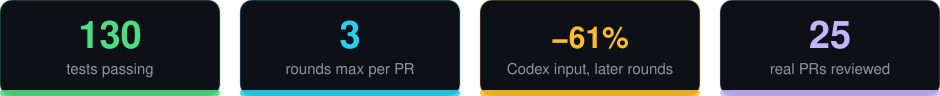
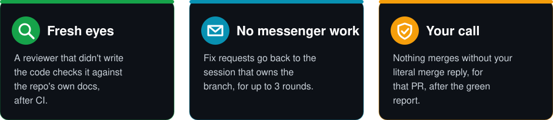

<div align="center">


# pr-gate

**Merge on a reply, not on a read.**
A skill that reviews each pull request, sends the fixes back to the session that wrote it, and asks you only one thing at the end: `merge`?

<a href="docs/reviewers.md"></a>
<a href="docs/reviewers.md"></a>
<a href="docs/reviewers.md"></a>
<a href="#install-by-hand"></a>
<a href="#install-by-hand"></a>
<a href="LICENSE"></a>

<br>



<br>



</div>

**Before:** you read the diff, paste findings into the right chat, and check back after every push.
**After:** you type `/pr-gate owner/repo 12`, then answer one word: `merge`.

<p align="center">
  
</p>

## Quick start

```bash
git clone https://github.com/EranTzarum/pr-gate.git ~/.claude/skills/pr-gate   # Codex: ~/.codex/skills, Cursor: ~/.cursor/skills
cd ~/.claude/skills/pr-gate && python3 -m unittest discover tests   # expected: Ran 137 tests ... OK
```

Then, in a session inside your repo: `/pr-gate owner/repo 12`. You need [`gh`](https://cli.github.com) logged in, Python 3 and `git`. Reviewer login and preferences: [the five steps below](#install-by-hand).

## Example

A PR adds a checkout discount helper. CI is red. Three rounds later:

```text
round 1  CI fail   codex   [high]   cart.py:13  cart total skips the last item (matches the CI log)
         → fix request sent, owner pushes
round 2  CI pass   claude  [high]   cart.py:8   percent not bounded: 150% gives a refund
                           [medium] cart.py:14  negative qty cancels other items
         → fix request sent, owner pushes
round 3  CI pass   codex   2 × medium remain
         → escalate: "3 rounds, still 2 medium. Fixed so far: … Options: …"
```

When a round comes back clean, you get this instead:

```text
PR owner/repo#12 "Add discount helper" is ready. Reply `merge` to merge it.
What it does: adds bounded percentage discounts and cart totals.
Checked: CI pass; claude review over 3 files, 2 rounds; repo docs: AGENTS.md.
tier: cheap (score 2: concurrency+1, isolation+1)
cost: 214k in (180k cached), 3 min
Left (low, optional): cart.py:3, MAX_ITEMS defined but never enforced.
Merging will: merge into main; then deploy.yml: npx supabase db push --linked
```

Measured on real pull requests: [what it caught, how fast, what it costs](docs/evals.md#what-it-did-in-practice).

## Spends where it matters

- **The model follows the risk:**
  - docs and tests get the lightest model;
  - ordinary changes get a cheap one;
  - a PR that touches auth, migrations, secrets, shell commands or deletes gets the strong one.
- **Rounds 2+ re-read only what changed:** Codex used 61% fewer tokens on a real PR. Over 194 reviews in 10 days, later rounds on the top model used 25-43% fewer.
- **Every review logs its cost.** See it with `python3 scripts/usage.py --since today` (`py -3` on Windows).
- **A budget in config hands work from Codex to Cursor** before your limits run out.
- **One seat list with an orchestrator:** `seats/seats.json` is a synced copy, and a test fails if the tier rules or a picked model drift from it.

Details: [docs/reviewers.md](docs/reviewers.md).

## Install by hand

Pick the tool you use (Claude Code, Codex or Cursor). Any one of them is enough: with a single tool, the reviewer is that same tool in a fresh, read-only run. A fresh context is what catches the writer's blind spots; a second model family is a bonus.

**Needs:** [`gh`](https://cli.github.com) logged in (`gh auth login`), Python 3, `git`.

**Easiest:** paste this repo's link into your agent and say *"install this skill"*. It follows [INSTALL.md](INSTALL.md).

Or by hand, in five steps:

**1. Get the skill** into the folder of the tool you use:

| You use | Run once |
|---|---|
| Claude Code | `git clone https://github.com/EranTzarum/pr-gate.git ~/.claude/skills/pr-gate` |
| Codex | `git clone https://github.com/EranTzarum/pr-gate.git ~/.codex/skills/pr-gate` |
| Cursor | `git clone https://github.com/EranTzarum/pr-gate.git ~/.cursor/skills/pr-gate` |

On Windows, `~` is `%USERPROFILE%`. Using two of these tools? Clone it once and copy (or link) the folder into the others.

**2. Check it:** inside the skill folder, `python3 -m unittest discover tests` (`py -3` on Windows). Expected: `Ran 137 tests ... OK`. No network calls; `gh` is mocked.

**3. Make sure your reviewer can answer.** Every reviewer is a plain CLI, so no plugin is needed to use a model from another tool. For each one you have:

| Reviewer | Logged in? | If not, log in | Quick test (expects `ok`) |
|---|---|---|---|
| Codex | `codex login status` | `codex login` | `echo "Reply with exactly: ok" \| python3 ~/.claude/skills/pr-gate/scripts/lean_run.py codex --model gpt-6.1-sol --cwd .` |
| Claude | `claude auth status` | `claude auth login` | same, with `claude --model sonnet` |
| Cursor | `cursor-agent status` | `cursor-agent login` | same, with `cursor --model composer-2.5` (slow to start: about 3 min) |

Use the skill folder you cloned into in the test command. Use `cursor-agent`, not `agent`: other tools install an `agent` command too. More (models, what each one runs): [references/engines.md](references/engines.md).

**4. Optional: save your preference** in `~/.pr-gate/config.json`, or just tell the agent *"review with Codex, and switch to Cursor when Codex is 80% used"* and it writes it:

```json
{ "reviewer": "codex", "budget": { "codex_5h_max_pct": 80, "codex_week_max_pct": 90, "fallback": "cursor" } }
```

**5. Run it** in a session inside your repo:

```text
/pr-gate owner/repo 12
```

In Codex or Cursor, say *"run pr-gate on PR 12"* if slash commands don't list skills. Without a saved preference it asks once which reviewer to use, offering the best one you have.

The optional inbox mod (Claude Code only, delivers fix requests to the session that wrote the PR) is in [docs/inbox-mod.md](docs/inbox-mod.md).

## Safety rules

- **Never merges without your literal `merge` reply**, for that PR, after the green report. Before merging it re-checks that the head SHA and CI are unchanged.
- **Never** pushes, changes repo settings, turns on auto-merge, or uses `--admin`.
- Every script's output is **redacted**: tokens, JWTs, keys and URL passwords are masked before anything is printed, stored or sent.
- **Reviewers are read-only**, and a test enforces it.
- **3 rounds per PR**, kept in `~/.pr-gate/state` and enforced: a 4th round needs your OK.
- **Never picks the priciest models**: `gpt-6-astra`, `claude-fable-*` and Cursor `auto` are refused, even from config.

## More

| Read | For |
|---|---|
| [docs/how-it-decides.md](docs/how-it-decides.md) | Why a fresh reviewer, when it stops for you, severities, what gets dropped |
| [docs/reviewers.md](docs/reviewers.md) | Pick a reviewer, model tiers and the change score, what a review costs, lean runs |
| [docs/evals.md](docs/evals.md) | What it did in practice, and the live runs |
| [docs/automation.md](docs/automation.md) | Running it unattended: not enabled; compares a local poll, a GitHub Action and a webhook, and recommends a 30-minute local poll after a few weeks of on-demand use |
| [docs/repo-map.md](docs/repo-map.md) | Every file and what it does |

## License

[MIT](LICENSE)
